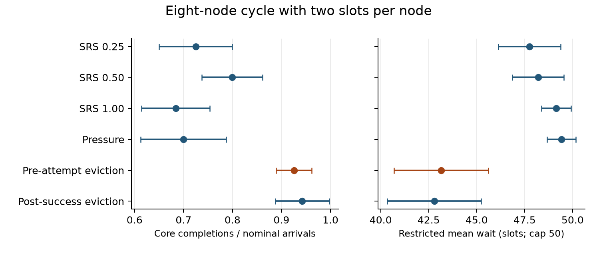

# Finite-lifetime recovery versus single random swap

On the prespecified eight-node cycle, evicting a blocking pair **before a fallible generation attempt** raised core service from 79.9% of nominal demand under single random swap to 92.6%. The paired gain was **12.6 percentage points** (95% interval 7.0–18.2, 12 seeds). Restricted mean request wait fell by 5.06 slots (2.82–7.30). The cost was substantial: the recovery policy used 52.5 generation attempts and 18.2 swaps per completion, versus 27.3 and 10.8 for single random swap. On a twelve-node cycle with four slots, single random swap delivered more service. These outcomes support a memory- and workload-dependent use of eviction. [Frozen design](Matched_Protocol.md) · [Seed-paired comparisons](evidence/matched/paired.csv)

## Primary comparison

Each node has two slots, one per physical neighbor. There is one opportunity per edge per slot, generation succeeds with probability 0.5, swaps succeed, and pairs expire at age 10. Three core endpoint pairs per seed carry a combined load equal to 10% of the network's potential successful generation rate when weighted by shortest-path length. Each policy sees the same demand, potential heralds and edge order. The observation window contains 1,500 slots after a 500-slot warm-up.

| Policy | Core service / nominal demand | Restricted wait, slots | Window arrivals unfinished at horizon | Drops per completion | Swaps per completion | Generation attempts per completion |
| --- | ---: | ---: | ---: | ---: | ---: | ---: |
| Single random swap, attempt probability 0.25 | 0.725 | 47.75 | 40.3% | 0 | 9.23 | 24.92 |
| Single random swap, 0.50 (primary reference) | 0.799 | 48.20 | 33.3% | 0 | 10.83 | 27.28 |
| Single random swap, 1.00 | 0.684 | 49.15 | 47.5% | 0 | 15.99 | 37.07 |
| Oriented pressure, no eviction | 0.700 | 49.42 | 44.7% | 0 | 13.81 | 33.84 |
| Oriented pressure, pre-attempt eviction | 0.926 | 43.15 | 15.6% | 7.17 | 18.19 | 52.48 |
| Oriented pressure, post-success eviction | 0.942 | 42.79 | 14.0% | 6.02 | 18.95 | 51.71 |

Entries are equal-weight seed means. Each cost ratio uses that seed's operations and completions on the same window. Core service includes deliveries to requests waiting from warm-up. Unfinished fraction uses the realized arrival cohort. Restricted wait caps each observed wait at 50 slots and includes all window arrivals with at least 50 slots of follow-up. It remains high even in the best-performing arm. [Measurements for all cells](evidence/matched/cells.csv)

Against pressure without eviction, pre-attempt eviction gained 22.6 points (14.2–30.9). The pre-attempt policy improved on the primary SRS reference in 11 of 12 seeds and on pressure alone in all 12. Allowing eviction only after success gave it an additional 1.7 points on average; the paired interval for pre-attempt minus post-success service was −4.5 to +1.2 points. Attributing the whole primary gain to foreknowledge of a successful herald would therefore miss the effect measured by the pre-attempt arm. [Paired results](evidence/matched/paired.csv)

## Where the ranking changes

Positive values favor pre-attempt eviction. Each difference below compares against SRS with attempt probability 0.5 using the same sparse workload in both arms. The secondary intervals are pointwise and unadjusted.

| Cycle | Slots/node | Lifetime | Other change from primary | Core-service difference in percentage points [95% interval] |
| --- | ---: | ---: | --- | ---: |
| 8 | 2 | 30 | None | +34.4 [24.6, 44.2] |
| 8 | 2 | 100 | None | +41.0 [28.8, 53.2] |
| 8 | 4 | 10 | None | −2.4 [−6.4, 1.6] |
| 12 | 2 | 10 | None | +2.6 [−1.3, 6.5] |
| 12 | 2 | 30 | None | +10.1 [5.3, 14.9] |
| 12 | 4 | 10 | None | −6.1 [−10.2, −2.0] |
| 8 | 2 | 10 | Swap success 0.8 | +5.3 [−2.6, 13.2] |
| 8 | 2 | 10 | Core load 35% | +7.5 [5.8, 9.3] |
| 8 | 2 | 10 | Lossless generation at 10% normalized load | −40.5 [−51.7, −29.2] |

Lossless generation synchronizes opportunities across links and doubles the absolute primary request intensity at fixed normalized load. Under that condition all twelve seed trajectories agreed exactly between pre-attempt and post-success eviction. With lossy links on the twelve-node, two-slot, lifetime-10 network, pre-attempt eviction cost 4.6 service points relative to post-success eviction (2.1–7.1). Treating replacement as guaranteed can matter quantitatively. [Full contrasts](evidence/matched/paired.csv)

### Why lossless links reversed the ranking

A follow-up separated request intensity from the order in which repeaters swap. Halving the normalized load on lossless links restored the primary experiment's exact request timestamps. Fixed-order pre-attempt eviction still served only 0.115 of nominal demand, against 0.903 for SRS. Giving the same pressure policy a fresh, uniformly shuffled pivot order each slot raised its service to 1.013. All twelve seeds improved. The paired gain over its fixed order was 0.898 [0.786, 1.009]. Pressure without eviction also improved when the order was shuffled. At two slots, each pivot can measure at most one pair of inputs per slot. The intervention changes which pivot acts first, with the same qubit budget, arrivals, generation outcomes and cutoff. [Post hoc study design and input fingerprints](evidence/matched-lossless/manifest.json) · [Paired diagnostic](evidence/matched-lossless/paired.csv)

We then froze a directional prediction and repeated the ordering comparison on **12 new seeds**. Fixed-order pre-attempt eviction completed zero requests in every 1,500-slot measurement window. Shuffled pre-attempt eviction completed **2,612** across the same windows, and SRS 0.5 completed **2,227**. The mean gain from changing only pivot order was **0.996 completions per nominal arrival** [0.954, 1.039], positive in all twelve seeds. [Held-out protocol](evidence/matched-lossless/holdout/protocol.json) · [Seed records](evidence/matched-lossless/holdout/seeds.csv) · [Held-out intervals](evidence/matched-lossless/holdout/paired.csv)

### An exact explanation for the ordering effect

**Proposition.** Consider a simple cycle of $n\ge4$ nodes labelled in cyclic order. Each node reserves one slot per neighbor, all links generate successfully once per slot, and swaps succeed. Use zero-patience pre-attempt eviction, oriented pressure swapping and service after swaps. Start empty, expire old pairs before generation, and allow virtual links spanning up to at least $n-2$ elementary links. In every slot the set of pairs offered to requests consists of the three edges of the triangle formed by the **last three nodes in the pivot visitation order**.

To see this, start a slot with any subset of the previous triangle. An elementary pair already on its own edge holds both dedicated slots there. On every other generation edge, any blocker can be evicted and a fresh elementary pair installed. Subsequent generations on different physical edges use different origin slots and leave that elementary pair in place. Thus swapping begins with the full elementary cycle, irrespective of the edge order, earlier service or expiry.

While at least four vertices remain, a visited pivot holds two pairs in opposite-facing slots and their distant partners share no pair. The full pivot satisfies pressure and performs one swap. This contracts the vertex, leaving a simple cycle of one fewer vertex, whose links cover disjoint consecutive arcs of the original cycle. On the last three vertices each prospective output is already present, so the pressure threshold stops further swaps. Every remaining arc has at most $n-2$ segments. Any triangle edge joining physical neighbors consists of their own elementary edge. Consumption can remove any subset of the triangle, which completes the induction for the next slot. [Executable check over every five-node pivot order](tests/test_lossless_cycle_order.py)

In ascending order on the eight-node cycle the final pairs are $(5,6)$, $(6,7)$ and $(5,7)$. The only eligible *nonneighbor* demand is therefore $(5,7)$. All twelve held-out demand sets omit it. In this model they remain unserved for arbitrarily long runs, even with finite expiry. The inventories continue to change each slot. This is a scheduling failure distinct from an inventory that never changes.

A new three-class workload drawn by the same rule includes $(5,7)$ with probability $3/20$. The zero-service prediction is conditional on the selected classes. [Held-out figure](evidence/matched-lossless/heldout-order.pdf)

With an independent uniform permutation every slot, the final triangle is a uniform three-node subset. A given pair is offered service with probability $s=6/[n(n-1)]$ per slot, or $3/28$ on the eight-node cycle. Opportunities are independent across slots and correlated across demand pairs. For one class with independent, identically distributed arrivals $A_t$ of finite mean $\lambda$, the queue follows $Q_{t+1}=\max(0,Q_t+A_t-I_t)$, where $I_t$ indicates that both endpoints survive. The reflected-walk formula and the strong law give $Q_t/t\to\max(0,\lambda-s)$ and a completion rate of $\min(\lambda,s)$. Every held-out core rate was below $3/28$. The proof explains the return of service and the sensitivity to node ordering under this synchronous, lossless model.

## Rare background requests and interruptions

The nearly sparse treatment gives every other pair a positive Poisson arrival rate while keeping the core request times identical. Background traffic adds 2% of core hop-weighted demand. At the primary generation rate and load the window averaged only 4.75 background requests on the eight-node cycle and 6.25 on the twelve-node cycle. A positive background rate gives a frozen stored pair a chance of release. The time to the first such request has a different meaning from the time required to complete a core request. [First-release analysis](Lockup_Extensions.md#first-release-under-rare-background-demand)

For the eight-node, two-slot network with sparse traffic and lifetime 10, the mean across seeds of the longest core interruption was 164 slots for SRS 0.5, 190 for pressure and 124 for pre-attempt eviction. In the nearly sparse case these became 176, 197 and 124. At lifetime 100, adding background requests shortened the longest interruption for pressure alone by 136 slots on average, with a wide interval from 310 slots shorter to 38 longer. Rare requests did not reliably eliminate long core outages in this observation window. Each seed record retains the per-pair interval lengths and the right-censored final interval for follow-up analysis. [Support contrasts](evidence/matched/background-sensitivity.csv) · [Full seed records](evidence/matched/runs.jsonl.gz)

## What the comparison measures

SRS follows the published link generation, simultaneous swap selection, swap failure and cutoff rules. A trace check against the pinned authors' implementation matched every surviving physical qubit address, pair age and segment count in 288 slots across three test cases with consumption suppressed. For the experiment, common per-class queues replace the paper's consumption process. The pressure arm settles swaps sequentially and can react to earlier pivots in the same slot. At two slots both protocols have qubits for at most one swap per pivot per slot. At four slots the pressure policy can use additional swaps. Actual swap counts are released. Classical control delay, continuous fidelity loss, device-specific attempt durations and the Q-CAST planned-path system are outside this study. [Published Algorithm 1](https://arxiv.org/html/2307.01406v2) · [Pinned author code](https://github.com/AlvaroGI/optimizing-cd-protocols/blob/3a68a05663a61dacefa59809646c55bcfaf2a493/main_cd.py) · [Trace checks](tests/test_srs_protocol.py)

The fixed design covered 24 physical and demand conditions, 12 independent seed blocks and six arms, for **1,728 trajectories**. The statistical unit is one seed. Rebuild the tables and vector figure with `python -m scripts.matched_srs_report evidence/matched`. [Artifact and replay instructions](evidence/README.md)
